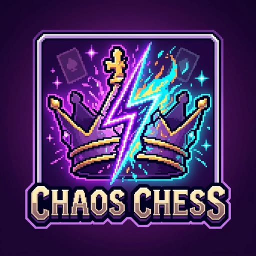

<p align="center"></p>

# Chaos Chess — v0.5 «Друзья и сезон»


Шахматы + колода заклинаний. Пиксель-арт, игра в браузере и как Telegram Mini App.
Играть: https://chess.138-124-126-138.sslip.io · Telegram: [@ChaosChessbot](https://t.me/ChaosChessbot)

## Быстрый старт
Нужен Node.js 22+ (встроенный `node:sqlite`) и Python 3 только для генерации графики.
```bash
cd server && npm ci && cd ..
cp server/.env.example server/.env      # без токенов игра работает как сайт
node --test tests/*.test.mjs            # тесты
PORT=8099 node --no-warnings server/server.mjs   # сервер + клиент: http://127.0.0.1:8099
```
База создаётся в `data/chaos.db` (в Git не хранится). Секреты — только в `server/.env`, пример — `server/.env.example`.

## v0.5 «Друзья и сезон»
- Приглашения друзей с наградами обоим (ступени 1/5/20, защита от накрутки), «Похвастаться» карточкой результата (shareMessage / Web Share).
- Турниры в группах Telegram: `/tournament 4|8`, сетка, часы 3+2, титул «Чемпион турнира».
- Монетизация только косметикой: магазин за Telegram Stars, донаты 50/150/500 ⭐ и значок «Меценат», пропуск сезона (бесплатная и платная дорожки, 10 уровней), реклама Adsgram за подсказку.
- Игровой бот: /start, комнаты, /paysupport, канал головоломок (бот-админ публикует головоломку дня в 10:00 МСК).

## v0.4 «Новый облик»
- Фигуры 24×24, палитра «Кость и обсидиан», доска «Камень», каменный интерфейс, карты с металлическими уголками. Генератор — `tools/style24.py`.
- 263 головоломки со ступенчатыми подсказками, меню паузы, настройки по разделам, повтор хода соперника.

## Что есть
- Режимы: против бота («Новичок», «Боец», «Мастер»), онлайн (комната по ссылке, быстрая игра, вход по коду), вдвоём на одном экране, обучение, головоломка дня, повтор партий.
- 34 карты: «Основа» (9), «Расширение» (13) и «Набор 2 · Буря» (12, механика заряда). Конструктор колод (до 8 своих) и 5 готовых колод: Основа, Контроль, Агрессия, Хаос, Буря.
- Режим «Хаос»: 8 событий каждые 8 кругов с объявлением за круг.
- Онлайн: сервер — арбитр, урезанное состояние (без чужой руки, колод, капканов), часы 3+2 / 7+5 / 15+10, переподключение 60 с, сдача, ничья по согласию, 8 эмоций.
- Профиль: имя, 12 аватаров, статистика, любимая карта, серия головоломок, история и повторы.
- Карточка результата (PNG) и отправка в Telegram. Скин фигур «Лёд и пламя». Две чиптюн-темы (свои, синтез на WebAudio).

## v0.3 «Полная игра»
- Башня Хаоса: 15 этажей, боссы на 5/10/12/15 (Ледяная королева, Некромант, Зеркальный рыцарь, Бомбардир), сюжетные вставки, награды.
- Прогресс: опыт и уровни, карты Расширения открываются уровнями и этажами (новичок начинает с 9 картами Основы), 3 задания в день, 18 достижений, коллекция.
- Драфт-арена: 20 выборов «1 из 3», игра с ботами до 3 поражений или 7 побед.
- Рейтинг Эло по быстрой игре, сезоны по 6 недель, 6 лиг, таблица лидеров, подбор по рейтингу.
- Зрители онлайн-партий (`?watch=<id>`), косметика за игру: 5 скинов фигур, 5 досок; режим для дальтоников.
- Админка `/admin.html` (токен `ADMIN_TOKEN` в `server/.env`): игроки, удержание D1/D7, партии, карты, события, бан.

## Структура
```
web/                 клиент (статические ES-модули, сборка не нужна)
  src/engine/        rules.js, cards.js (карты, колоды), game.js (ход, хаос, боссы), campaign.js, puzzle.js
  src/bot/           бот: негамакс + форсированный поиск, Web Worker
  src/ui/            main.js, meta.js (прогресс), board.js, net.js, store.js, music.js, share.js, sfx.js, tg.js, tutorial.js
  puzzles.json       45 головоломок (tools/make_puzzles.mjs)
server/              server.mjs (HTTP + WebSocket), db.mjs (SQLite), ladder.mjs (рейтинг, сезоны, аналитика), redact.mjs, auth.mjs (initData HMAC)
tests/               perft, карты Основы и Расширения, хаос, бот и головоломки, онлайн
tools/               графика (python), fuzz, bench_bot, balance, load_test, make_puzzles, backup_db
reports/             последние отчёты проверок
```

## Команды (из папки chaos_chess)
```bash
N=../runtime/node/bin/node
$N --test tests/*.test.mjs                           # все тесты
$N tools/fuzz.mjs 10000                              # случайные партии + инварианты
$N tools/bench_bot.mjs 24 master fighter             # матч уровней бота
$N tools/balance.mjs 2000 2 > reports/balance.md     # баланс карт
$N tools/load_test.mjs ws://127.0.0.1:8099/ws 50 80  # нагрузка и утечки
$N tools/make_puzzles.mjs 45 > web/puzzles.json      # головоломки
PORT=8099 $N --no-warnings server/server.mjs         # сервер вручную
```

## Telegram Mini App
1. В @BotFather: `/newbot` → `/newapp` (или Menu Button) → URL `https://chess.138-124-126-138.sslip.io`.
2. В `server/.env` указать `BOT_TOKEN` (включает проверку initData) и `TG_APP_LINK=https://t.me/<бот>/<app>` — тогда приглашения открываются прямо в Telegram (`startapp=room_XXXXX`). Затем `sudo systemctl restart chaos-chess`.
3. Без бота игра работает как сайт: вход по токену устройства, приглашение — обычная ссылка `?room=XXXXX`.
